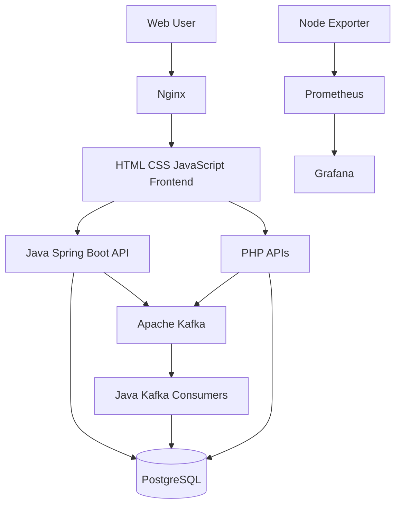

# KrushiSetu – Event-Driven Farmer Benefit Management Platform

KrushiSetu is a demonstration project that explores a modern event-driven application for farmer registration, benefit status management, event tracking, and infrastructure monitoring.

The project integrates Java Spring Boot, PHP, Apache Kafka, PostgreSQL, Nginx, Prometheus, and Grafana.

## Project Objectives

- Farmer registration through a web interface.
- Event-driven communication using Apache Kafka.
- Farmer benefit status management.
- PostgreSQL database integration.
- Event monitoring, filtering, and search.
- Infrastructure monitoring using Prometheus and Grafana.

## Architecture
### Visual Architecture




## Implemented Features

### 1. Farmer Registration
- Register farmers through the web interface.
- Process registration requests using Java Spring Boot.
- Store farmer records in PostgreSQL.
- Publish `FarmerRegistered` events to Kafka.

### 2. Farmer Records
- Retrieve registered farmer records through the Java API.
- Display farmer information in the frontend.

### 3. Benefit Management
- Submit benefit status updates through the PHP API.
- Publish `BenefitStatusUpdated` events to Kafka.
- Process benefit events through a Java Kafka consumer.
- Store benefit status and event receipts in PostgreSQL.

### 4. Benefit History
- Retrieve benefit status history through the PHP API.

### 5. Event Monitoring
- View event processing information.
- Filter by farmer ID and event type.
- Search using partial event IDs.
- View event statistics and Kafka topic information.
- Use pagination and automatic refresh.

### 6. Infrastructure Monitoring
- Node Exporter collects Linux system metrics.
- Prometheus collects and stores metrics.
- Grafana visualizes infrastructure metrics.
- A CPU utilization dashboard panel is configured.

## Kafka Topics

| Topic | Purpose |
|---|---|
| `farmer.registered` | Farmer registration events |
| `benefit.status.updated` | Farmer benefit status updates |

## Database

PostgreSQL database: `krushisetu`

Main tables:
- `farmers`
- `benefit_status`
- `farmer_event_receipts`
- `php_farmer_event_errors`
## Repository Structure

```text
krushisetu/
├── backend/
│   ├── java/
│   └── php/
├── frontend/
│   ├── css/
│   ├── js/
│   └── HTML pages
├── monitoring/
├── docs/
├── .gitignore
└── README.md

```

## Configuration

Never commit real passwords, credentials, or private keys.

### Java

See `backend/java/.env.example` for the required environment variables:
- DB_URL
- DB_USERNAME
- DB_PASSWORD
- KAFKA_BOOTSTRAP_SERVERS

### PHP

See `backend/php/database.ini.example` and `backend/php/.env.example` for configuration examples.

## Development Environment

Developed and tested on Ubuntu 24.04 LTS running in a Proxmox LXC container.

## Security Notes

- This is a learning and portfolio project, not a production-ready government platform.
- Use fictional farmer records and test data.
- Keep credentials outside the Git repository.
- Secure services before exposing them externally.

## Future Improvements

- Docker deployment.
- CI/CD using Jenkins or GitHub Actions.
- Role-based authentication.
- Application logging and tracing.
- Additional monitoring dashboards and alerts.
- Automated testing and high availability.

## Author

**Kabinder Singh**  
Infrastructure & DevOps Engineer

**Profiles:**
- LinkedIn: [Kabinder Singh](https://www.linkedin.com/in/kabinder-singh-21911888/)
- GitHub: [kabinder143](https://github.com/kabinder143)

**Project:** KrushiSetu – Event-Driven Farmer Benefit Management Platform

KrushiSetu demonstrates the integration of backend development, event-driven architecture using Kafka, databases, Linux infrastructure, and monitoring.
---

## Application Screenshots

### 1. Farmer Registration


### 2. Farmer Records


### 3. Benefit Management


### 4. Event Monitoring Overview


### 5. Event History and Search


---

## Project Demonstration

KrushiSetu is a learning and demonstration project showcasing integration between Java, PHP, Apache Kafka, PostgreSQL, and infrastructure monitoring tools.

